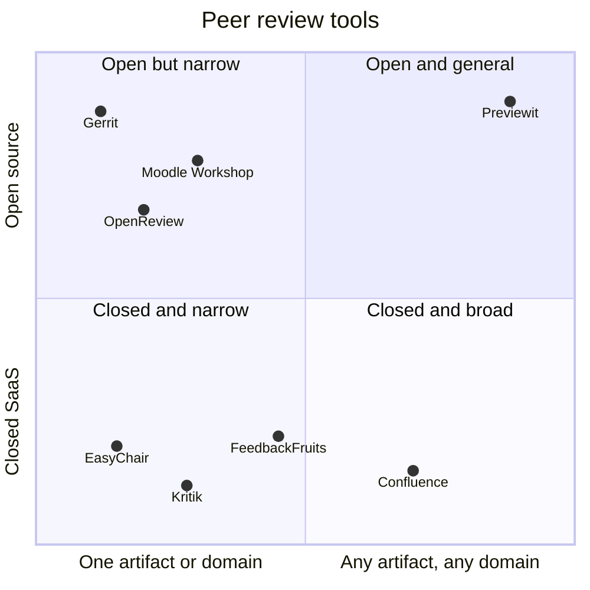

# Competitors and positioning

## Landscape

| Competitor | What it is | Strength | Gap we use |
|---|---|---|---|
| **FeedbackFruits** | Closed SaaS tool suite inside the LMS; 200+ institutions, 28 countries | Pedagogy depth, LMS partnerships, institutional sales | Education only; quote-based institution deals; no self-host; teacher cannot just start |
| **Moodle Workshop** | Peer-assessment activity built into Moodle core | Free, already installed | Dated UX, hard setup, weak annotation and group-to-group review, Moodle only |
| **Kritik, Peerceptiv** | Closed peer-assessment SaaS, per-student pricing | Calibration, grading analytics | Often student-paid, written work focus, North America focus |
| **EasyChair** (also OpenReview, HotCRP) | Conference submission and review | De facto standard in CS venues; per-submission pricing with a small free tier | Papers only; dated UX; no in-document annotation; not usable for courses or teams |
| **Gerrit** (also GitHub/GitLab PRs) | Open-source code review for Git | Deep Git workflow, line-level review, CI gates | Code only; no rubric, no anonymity, no allocation; not for non-developers |
| **Confluence** | Team wiki with inline comments | Ubiquitous in companies; ecosystem | Comments are not a review process: no rounds, criteria, allocation, blinding or decisions |

**Real competitor in year 1:** Moodle Workshop ("free and good enough") and the status quo of email plus spreadsheets. FeedbackFruits is the benchmark buyers will name.
**Not competitors in year 1:** Gerrit and Confluence. They are adjacent; later we *integrate* with them (review a Git change or a Confluence page through a plugin) rather than replace them.

## Positioning map

## Positioning statement

> For teachers, and later any organisation, who need peers to review work, **Previewit** is the open-source review platform that starts from a single link and handles any artifact and any party structure. Unlike single-purpose tools (FeedbackFruits for courses, EasyChair for papers, Gerrit for code), Previewit runs one review process, with rubrics, rounds, allocation and anonymity, across all of them, hosted in the EU, with source code anyone can inspect.

## Differentiators (keep to these four)

1. **Easy:** link in, review out. Minutes to first review; no procurement to start.
2. **General core:** Party model (individual, group, organisation) and artifact plugins. One process, many artifact types.
3. **Open:** AGPL source, EU-hosted, exportable data, no lock-in. Self-hosting is possible but expert-only (Debian); do not sell it as easy.
4. **Cross-organisation:** review across institutions and networks, not only inside one tenant.

## Where we are weaker (be honest in sales)

No calibration or grading analytics yet; no track record; one-person support; plugin ecosystem unproven.
