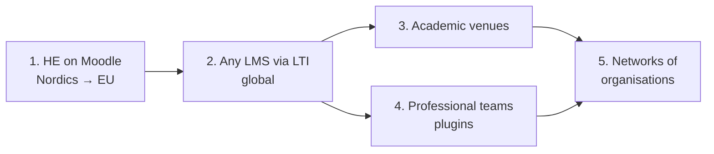

# Market analysis

_Status: Nov 2026. Figures marked (A) are assumptions to validate._

## Problem

Peer review is everywhere (courses, papers, code, designs, patents) but tooling is split by artifact and by sector. Each tool hard-codes one workflow. Organisers fall back on email, spreadsheets and shared folders. Pain is highest where volume is high and time is short: a teacher with 200 students.

## Trends

- **Generative AI** pushes education toward process-based and authentic assessment; peer review is a cheap way to do it at scale.
- **Vacuum in the simple tier:** Peergrade and Eduflow closed for higher education after the Multiverse acquisition (end of 2023). Kritik and FeedbackFruits ran migration offers. Teacher-level, self-serve peer review has no obvious home.
- **Institutional tools are quote-priced:** FeedbackFruits publishes no price list; cost depends on student numbers and tools chosen.
- **Moodle is large but not growing:** about 25% share in Europe, 73% in Latin America, ~60% of higher education in Oceania, 16% in North American higher education; share is slowly eroding. Big installed base, underserved by modern add-ons.
- **Digital sovereignty / GDPR:** European public institutions favour open-source, EU-hosted or self-hosted tools.
- **Open standards:** LTI 1.3 makes one integration work across Moodle, Canvas, Brightspace, Blackboard.

## Segments and order of entry

| # | Segment | Buyer | Why / why not now |
|---|---|---|---|
| 1 | **Higher education on Moodle** (Nordics, then EU) | Teacher first, then e-learning unit | Founder's home turf, acute pain, LTI channel, clear budget line |
| 2 | Any LMS via LTI; vocational, K-12 | Same | Same product, wider reach |
| 3 | Academic venues (workshops, small conferences, journals) | Chair / editor | Founder's network; needs venue preset |
| 4 | Engineering and professional teams (design, docs, 3D, video) | Team lead | Needs plugins; strong incumbents for code |
| 5 | Networks of organisations (consortia, funders, IP/patent pools) | Programme office | Unique fit for cross-org orchestration; long sales cycle |

## Sizing (order of magnitude)

| Layer | Definition | Estimate |
|---|---|---|
| TAM | All structured peer review, all sectors | Not credibly quantifiable; do not quote a number |
| SAM (beachhead) | European HE institutions on Moodle | ~3,500 institutions (A) × 25% ≈ **~900** |
| SAM value | Depends on storage-based price above 50 MB | Not estimated yet; measure storage per course in pilot 1 |
| SOM year 1 | Paying organisers | **~5**, revenue covers cash costs |
| Bottom-up reach | Organisers on the free tier | 30 teachers, 1,500 students |

The beachhead is small on purpose. It buys learning, not income. Scale comes from segment 2 (global LMS base; Moodle sites alone report 500M+ users) and from the horizontal expansion in segments 3–5.

## Customer jobs (education)

- Teacher: set up a review round in minutes, no allocation spreadsheet, grades back in Moodle.
- Student: clear task list, safe anonymity, useful feedback.
- E-learning unit: GDPR-compliant, accessible (WCAG 2.2 AA), SSO, low support load, no lock-in.

## Sources

- FeedbackFruits scale: <https://feedbackfruits.com/about-us>
- FeedbackFruits pricing model: <https://edtechimpact.com/products/feedbackfruits/>
- Peergrade/Eduflow closure: <https://www.kritik.io/kritik-an-alternative-to-peergrade-eduflow>, <https://www.teachfloor.com/blog/best-kritik-alternatives>
- Moodle share and users: <https://onedtech.philhillaa.com/p/observations-on-higher-ed-lms-market>, <https://listedtech.com/blog/lms-in-oceania/>, <https://schema-knowledgebase.pages.dev/research-and-evaluation/open-edx-competitor/platform/02-moodle> (secondary source; verify before quoting externally)
