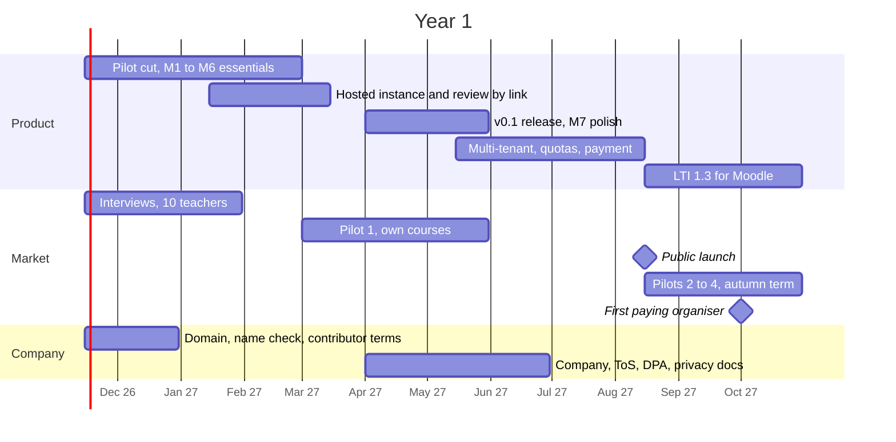

# Year 1 plan (Nov 2026 – Oct 2027)

**Goal for month 12:** teachers outside the founder's own courses run reviews on `peereview.it` unaided, and the first organisers pay.
Starting point: milestone M0 done (see `docs/PLAN.md`).

**Constraints:** solo founder, 2 days a week (about 90 working days in the year), free-time side activity, no external funding.

## Roadmap

## Quarters

| Quarter | Focus | Deliverables | Exit KPI |
|---|---|---|---|
| **Q1** Nov–Jan | Build the pilot cut | M1–M4; domain; 10 teacher interviews; 2 colleagues agree to try it in autumn | Interviews confirm top 3 pains |
| **Q2** Feb–Apr | First real use | Text + PDF review, one round, anonymity; hosted instance; review by link; pilot in own course | 1 course, 50+ students, round completed |
| **Q3** May–Jul | Make it a service | v0.1 release; multi-tenant; free-tier quotas (50 MB, 100 shares); payment; legal docs; company registered before first invoice | A stranger sets up a round unaided in < 10 min |
| **Q4** Aug–Oct | Prove demand | Public launch before term; 2–4 pilots at other institutions; LTI 1.3; case study from pilot 1 | 5 paying organisers; revenue covers cash costs |

Academic calendar drives timing: pilots must be agreed before term starts (January and August).
Moodle before LTI: teacher pastes the review link into the course; scores export as CSV for the Moodle gradebook.

## Month-12 targets

| Metric | Target |
|---|---|
| Institutions with active courses | 3 |
| Organisers (teachers) active | 30 |
| Students who completed a review | 1,500 |
| Paying organisers | 5 |
| Revenue | ≥ cash costs (hosting, domain, company) |
| Setup time, sign-up to allocated round | < 10 min |
| External contributors | 3 |

## Capacity rule

About 90 days: roughly 60% product, 25% pilots and users, 15% company and community. Anything not serving the pilot or the hosted path waits for year 2.

**Deferred to year 2:** plugin API v0.2 and the first non-document plugin, academic-venue preset, code review, institutional sales, calibration and analytics.

## Decision gates

| When | Question | If no |
|---|---|---|
| End Q1 | Do teachers confirm the pain and agree to try it? | Re-segment (venues or teams) before building further |
| End Q2 | Did the pilot round complete with good feedback? | Fix UX first; move launch to January 2028 term |
| End Q4 | Do organisers pay once they hit a free limit? | Revisit the limit and price; add a paid institution option |
