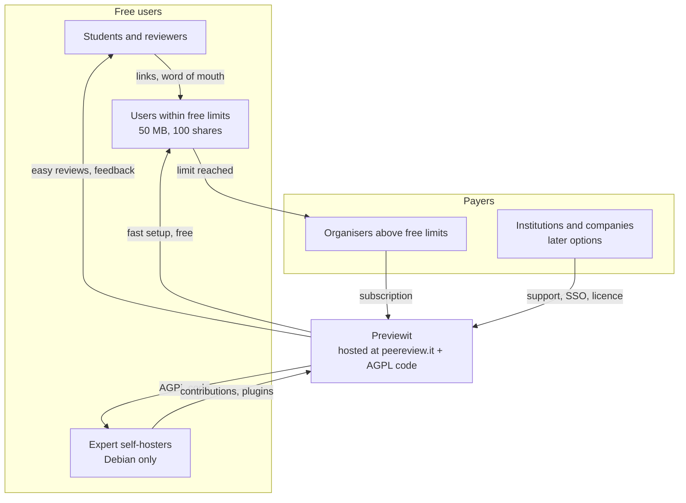

# Business Model Canvas

| Block | Content |
|---|---|
| **Customer segments** | 1) University teachers and e-learning units on Moodle. 2) Any LMS institution. 3) Academic venues. 4) Professional teams. 5) Networks of organisations. Users who never pay: students, reviewers. |
| **Value propositions** | Peer review made easy: a link starts a review. One process for any artifact (plugins) and any party (individual, group, organisation). Rubrics, rounds, allocation, anonymity built in. Open source, EU-hosted, Moodle-ready; self-hosting possible for experts (Debian only). |
| **Channels** | `peereview.it` link (viral), Moodle plugin directory and LTI 1.3, GitHub, academic network and conferences (MoodleMoot, EUNIS, edtech tracks), teacher word of mouth, research papers. |
| **Customer relationships** | Self-serve for teachers; community (GitHub issues, discussions); pilot partnerships with co-design; light-touch account management for institutions. |
| **Revenue streams** | Hosted use above the free limits (50 MB of storage, 100 shares per user), paid by the organiser of the review. Students and reviewers never pay. Later options: support and SLA, SSO and DPA for institutions, commercial (non-AGPL) licence. |
| **Key resources** | Codebase and plugin API; domain and brand; founder's research and teaching network; community; EU hosting. |
| **Key activities** | Product development; Moodle/LTI integration; pilots and evidence; community and plugin-author support; hosting operations and security. |
| **Key partners** | Pilot universities; Moodle community and Moodle partners (resellers/hosts); plugin authors; EU cloud provider; later: research consortia and funders. |
| **Cost structure** | Bootstrapped. Founder time, 2 days a week (dominant); hosting; domain; company and legal (ToS, DPA); AI coding tools. No external funding. |

## Value and money flow

## Key assumptions to test

1. Teachers will adopt without institutional approval if setup takes under 10 minutes.
2. Organisers pay once they pass a free limit instead of deleting files or leaving.
3. A link-based request spreads use beyond the course.
4. Third parties will write artifact plugins once the API is stable.
