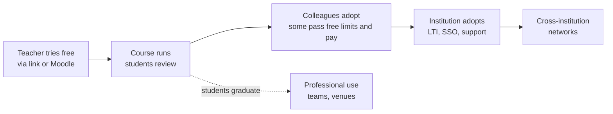
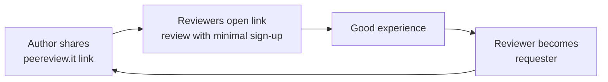

# Strategy

**Mission:** make peer review easy.
**Vision:** the default place to send anything for peer review: `peereview.it`.

## Strategic choices

| Question | Choice |
|---|---|
| Where to play first | Higher education on Moodle; Nordics, then EU |
| How to enter | Bottom-up: teacher starts free, institution pays later |
| How to win | Easiest setup + open source + general core |
| How to go global | Product-led and community-led, not sales-led |
| How to make money | Hosted service, free under 50 MB of storage and 100 shares per user; the organiser pays above that |
| Hosted or self-hosted | Hosted-first. Self-hosting is free (AGPL) but expert-only by design: Debian Linux only, strong skills and good hardware |
| How to fund it | Bootstrapped; solo founder, 2 days a week |
| What not to do in year 1 | Code review, enterprise sales, extra plugins, custom features for single customers |

## Born global: mechanics

- English first; UI translatable (EN + FI at launch).
- Distribution through global channels: GitHub, Moodle plugin directory, LTI 1.3 (works in any LMS), the public link.
- Self-serve sign-up and card payment; no country-specific sales needed.
- Self-hosting remains possible for organisations with data-residency rules and the skills to run it.
- Academic network as reach: every pilot teacher has co-authors abroad.

## Land and expand

## Growth loop

Every review request exposes new people to the product.

## Pricing

Decided: free under 50 MB of storage and up to 100 shares per user; students and reviewers never pay; the organiser of the review pays. An organiser can be a teacher, a team or an institution.

| Tier | For | Price |
|---|---|---|
| Free hosted | User under 50 MB and 100 shares | €0 |
| Paid hosted | Organiser above either limit | Steps; placeholder: 1 GB and unlimited shares ~€5, 10 GB ~€20 per month; more on request |
| Self-hosted | Experts on Debian with good hardware | Free, AGPL, unsupported |
| Later options | Institutions, companies | Support/SLA, SSO and DPA, commercial licence |

Consequences to watch:

- Text-only courses stay free for ever. Revenue comes from PDF-heavy courses and, later, storage-heavy plugins (video, 3D). Plugins are the revenue driver, not only the vision.
- 50 MB costs almost nothing to host. The real cost of the free tier is support and abuse of public links; needs rate limits, upload scanning and a takedown process.
- The storage limit is assumed per organiser account. A share is assumed to be one artifact sent for review by link, counted for life against the user who starts it.
- Self-hosting difficulty should come from what we choose not to build (installer, container image, small-server mode, support), not from slow or heavy code: the hosted site runs the same code and pays for the same hardware.

## Defensibility

1. Plugin ecosystem (artifact types written by others).
2. Cross-organisation network: reviewers and reputations that carry across spaces.
3. Open-source trust and community; AGPL plus a contributor agreement keeps dual licensing possible.
4. Research credibility: publish evidence from pilots.

## Risks

| Risk | Mitigation |
|---|---|
| Moodle Workshop is free and "good enough" | Win on setup time, UX, annotation, group reviews; show a side-by-side demo |
| Long institutional sales cycles | Teacher-led adoption first; revenue target for year 1 stays modest |
| Founder capacity (2 days a week) | Narrow scope; Claude Code for throughput; defer plugins and venues to year 2 |
| Scope creep from "review anything" | One preset (education), two artifact types (text, PDF) in year 1 |
| AGPL deters companies | Commercial licence as paid option |
| Storage pricing earns too little | Gate at end of year 1: revisit limit, price, or add a paid institution option |
| Hard self-hosting costs open-source goodwill and contributors; under AGPL anyone may publish an easy installer | Say openly that self-hosting is unsupported; compete on hosted convenience; keep the developer setup easy for contributors |
| Abuse of free hosting and public links | Rate limits, upload scanning, takedown process, verified email for organisers |
| Student data incident | Privacy by design, EU hosting, DPA template, security tests from day one |
