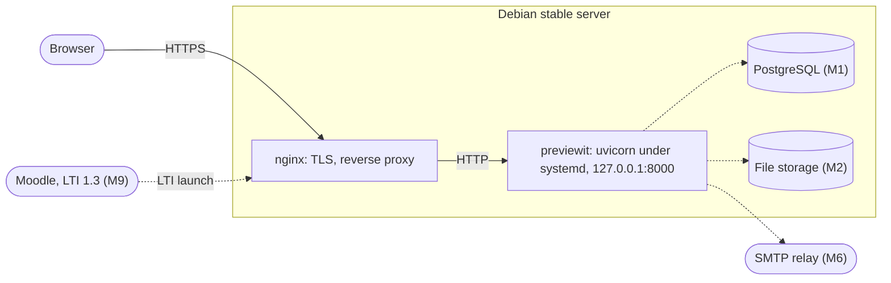

# Deployment manual

**Read first.** Self-hosting is for experts and is unsupported ([ADR 0005](../adr/0005-hosted-first-debian-only.md)). The easy path is the hosted site. There is no installer, no container image and no support for other systems.

**Status (M0).** What can be deployed today is the walking skeleton: a landing page and a health check. There is no database, sign-in, file storage or configuration file yet. Sections marked *planned* will be written when the milestone lands.

**Tested:** the dependency install and the start command in section 4, on Python 3.13. **Not tested:** the systemd unit and nginx configuration; treat them as an outline to adapt.

## 1. Requirements

| Item | Requirement |
|---|---|
| Operating system | Debian stable (13). Nothing else. |
| Python | Debian's `python3` (project needs 3.12 or newer) |
| Tools | `git`, `curl`, `uv` |
| Reverse proxy | nginx with TLS |
| Database | PostgreSQL, from M1 (*planned*). SQLite is for development only. |
| Hardware | Provisional: 4 CPU cores, 8 GB RAM, SSD storage. No load tests exist yet; figures will be set in M7. |
| Skills | Linux administration, systemd, nginx and TLS, PostgreSQL backup and restore, security patching |

## 2. Runtime view



Solid lines exist today; dotted lines are planned.

## 3. Install

```bash
sudo apt-get update
sudo apt-get install -y python3 git curl ca-certificates nginx
sudo adduser --system --group --home /opt/previewit previewit
sudo -u previewit -H sh -c 'curl -LsSf https://astral.sh/uv/install.sh | sh'
sudo -u previewit -H git clone https://github.com/jaateixeira/prreview.it /opt/previewit/app
cd /opt/previewit/app
sudo -u previewit -H env UV_PYTHON_PREFERENCE=only-system \
  /opt/previewit/.local/bin/uv sync --frozen --no-dev
```

`--frozen` installs exactly what `uv.lock` pins; `--no-dev` leaves out test tools.

## 4. Run

Start command (this is what the service runs):

```bash
/opt/previewit/app/.venv/bin/uvicorn previewit.bootstrap:create_app --factory \
  --host 127.0.0.1 --port 8000 --workers 2 \
  --proxy-headers --forwarded-allow-ips 127.0.0.1
```

`/etc/systemd/system/previewit.service`:

```ini
[Unit]
Description=Previewit
After=network.target

[Service]
User=previewit
Group=previewit
WorkingDirectory=/opt/previewit/app
ExecStart=/opt/previewit/app/.venv/bin/uvicorn previewit.bootstrap:create_app --factory --host 127.0.0.1 --port 8000 --workers 2 --proxy-headers --forwarded-allow-ips 127.0.0.1
Restart=on-failure
NoNewPrivileges=true
PrivateTmp=true
ProtectSystem=full

[Install]
WantedBy=multi-user.target
```

```bash
sudo systemctl daemon-reload
sudo systemctl enable --now previewit
curl -s http://127.0.0.1:8000/healthz    # prints: ok
```

## 5. Reverse proxy and TLS

`/etc/nginx/sites-available/previewit` (link it into `sites-enabled`):

```nginx
server {
    listen 80;
    server_name review.example.org;

    location / {
        proxy_pass http://127.0.0.1:8000;
        proxy_set_header Host $host;
        proxy_set_header X-Forwarded-For $proxy_add_x_forwarded_for;
        proxy_set_header X-Forwarded-Proto $scheme;
    }
}
```

```bash
sudo apt-get install -y certbot python3-certbot-nginx
sudo certbot --nginx -d review.example.org
```

Set an upload size limit (`client_max_body_size`) when submissions arrive in M2.

## 6. Update

```bash
cd /opt/previewit/app
sudo -u previewit -H git pull --ff-only
sudo -u previewit -H env UV_PYTHON_PREFERENCE=only-system \
  /opt/previewit/.local/bin/uv sync --frozen --no-dev
sudo systemctl restart previewit
```

From M1, run database migrations before the restart (*planned*). Read the release notes; the plugin API is unstable until version 0.2.

## 7. Planned sections

| Topic | Milestone |
|---|---|
| Configuration (settings and secrets) | M1 |
| PostgreSQL setup, migrations, backup and restore | M1 |
| File storage location, size limits, backup | M2 |
| Outgoing email | M6 |
| Monitoring, logs, performance budgets | M7 |
| Quotas and payment (hosted mode only) | M8 |
| LTI 1.3 registration in Moodle | M9 |

## 8. Licence duties

Previewit is AGPL-3.0-or-later. If you run a modified version for others over a network, you must offer them your source. The page footer links to `SOURCE_URL` in `src/previewit/adapters/web/app.py`; point it at your own repository if you change the code.
