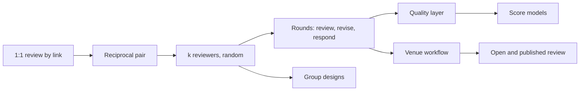

# Peer review designs: what the literature says

Literature scan, November 2026. Covers educational peer assessment (the year-1 market), scholarly review and code review. Keys in brackets point to the reference list. Section 7 maps findings onto [PLAN.md](../PLAN.md). The review designs used in other industries are drawn in [review-designs.md](review-designs.md).

Words follow the [glossary](../glossary.md). Titles in the reference list keep their original wording.

## 1. Bottom line

1. **Peer review works, and it is robust to design.** Across 54 controlled studies the effect on performance is g = 0.31, and it beats both no assessment and teacher assessment [Double20]. Most design moderators were not significant, so a simple design is a legitimate design.
2. **Reviewing teaches at least as much as being reviewed**, provided reviewers write comments and do not only score [Lund09, Cho11, Patchan15, Nicol22].
3. **One reviewer can be enough for formative feedback; 3 to 5 are needed when scores matter** [Cho06, Xiong23].
4. **Support for the reviewer is the best-evidenced lever**: training, criteria, prompts [Li20, Horn25]. Support for the receiver has almost no evidence yet [Horn25].
5. **Comments get used when they are understood**: say where the problem is, what it is, and what to do [Nelson09, Patchan16]. Comments repeated by several reviewers are acted on more [Wu20].
6. **Anonymity is a trade-off, not a rule**: more critical feedback and more comfort, but slightly lower agreement with teacher marks [Pan19, Li16].
7. **Scores are noisy everywhere**, including top conferences, where about half of accepted papers would change on re-review [Bey23]. Treat peer scores as estimates and show the spread.

## 2. Evidence base

| Synthesis | Scope | Main finding |
|---|---|---|
| [Falch00] | 48 studies, 1959 to 1999 | Peer and teacher marks correlate r = .69; best with global judgements on well-understood criteria |
| [Li16] | Studies since 1999 | r = .63. Higher for individual work, random matching, non-anonymous, scores plus comments, and when peers help write the criteria |
| [Double20] | 54 studies, 141 effects | g = 0.31 overall; 0.28 against teacher assessment; no clear difference from self-assessment. Grading adds value only at tertiary level (g = 0.55) |
| [Li20] | 58 studies, 134 effects | Rater training is the strongest moderator; computer-mediated beats paper |
| [Huis19] | 24 studies, academic writing | Comments plus scores beat either alone; several peers trend better than one |
| [Horn25] | 32 studies, 3,806 learners | Instructional support adds g = 0.47; support for giving feedback raises feedback quality (g = 0.72) |
| [Pan19] | 14 anonymity studies | Anonymity gives more critical feedback and better perceptions; effects depend on context |
| [Xiong23] | 374 courses, 88 institutions | Reliability depends on real variation in quality on each rubric item; 3 to 5 raters; best on first drafts |
| [Alq23] | 449 studies, 27 design elements | Only five prototypical designs dominate research (section 3) |

## 3. The design space

Typologies grew from 17 variables [Top98] to 20 in five clusters [Giel11] to 44 elements [Top21]. In practice, published designs cluster into five types [Alq23]:

| Share | Prototype |
|---|---|
| 33% | Online, formative, anonymous, random, within-class, written comments, with revision |
| 26% | Online, summative, anonymous, random, scoring only, no revision |
| 22% | Face to face, formative, identified, self-selected partners, oral and written, with revision |
| 13% | Online, formative, anonymous, random, between groups, scores and comments, with revision |
| 7% | Online, summative, identified, matched by domain, scoring only |

Dimensions that matter for a platform:

| Dimension | Options | What the evidence says |
|---|---|---|
| Purpose | Formative, summative, both | About 60% of studies are formative [Alq23]; bias rises when peer marks count toward grades [SPARK19] |
| Output | Comments, scores, ranking, pairwise choice | Comments carry the learning; add scores for accuracy [Li16, Huis19] |
| Reviewers per Submission | 1, k, all | 3 to 5 for scores [Cho06, Xiong23]; three already gives a reliable aggregate [Rel24] |
| Allocation | Random, self-selected, by expertise, manual | Random gives the best agreement with teachers [Li16] |
| Anonymity | Open, one side hidden, both hidden, fading | Section 5, practice 6 |
| Unit | Individual or group, on either side | Individual work is rated more accurately than group work [Li16] |
| Rounds | One shot; draft, review, revise | Repeated practice trends better (g = 0.37 against 0.19) [Double20] |
| Reviewer quality control | None, training, calibration, review-of-review, spot checks | Section 4 |

## 4. Design ladder: from 1:1 to advanced

| Design | How it works | Evidence and examples | Previewit today |
|---|---|---|---|
| **1:1 review** | One author, one reviewer, comments only | Enough for formative gains; less reliable for scores | Built: share link (M2) |
| **Reciprocal pair** | A and B review each other | The classic classroom form; reciprocity bias exists but is small [Magin01] | Built: allocation (M4) |
| **k-regular random** | Everyone reviews k and receives k | SWoRD: reciprocal review with back-reviews and rewriting [Cho07]; Coursera: five reviews given, four received, median score [Piech13] | Built: random and round-robin (M4) |
| **Multi-round** | Draft, review, revise, author response | Review first drafts, not final ones [Xiong23] | Rounds built (M4); author response planned (M6) |
| **Calibration** | Reviewers first score exemplars with known marks; accuracy gates or weights them | Calibrated Peer Review: three exemplars, competency index 1 to 6 [CPR]; feedback on one's grading bias improves accuracy [Kulk13] | Deferred (word reserved in the glossary) |
| **Review-of-review** | Authors rate the helpfulness of each Review | Raises review quality [Patchan18, Xiong23]; rating reviews is itself noisy and favours long reviews [Gold25] | After v0.1 in PLAN |
| **Spot checks** | Staff grade a sample; reviewers start supervised and are promoted when reliable | Mechanical TA [Wright15, MTA2] | Proposed |
| **Score models** | Median; reviewer bias and reliability weights; ranking instead of rating | Bias-corrected models improve accuracy on 63,199 grades [Piech13]; ordinal grading matches cardinal [Raman14]; rankings sidestep miscalibration [Shah22] | CSV export planned (M7) |
| **Comparative judgement** | Reviewer picks the better of two; pairs build a scale | ComPAIR [Potter17]; adaptive pairing can inflate reliability [Verh22] | Blocked: a ReviewTask pairs one reviewer with one Submission (ADR 0014) |
| **Group to group** | A Group writes one shared Review of another Group's Submission | Lower rating accuracy than individual work [Li16]; have members review individually where possible [Schunn] | Built: Party model, shared Review (M5) |
| **Teammate evaluation** | Members rate each other's contribution; a factor turns a group mark into individual marks | CATME behavioural anchors in five areas [Ohland12]; WebPA; SPARKPLUS factors [Willey08] | Blocked: the target is a Submission, not a Party |
| **Venue workflow** | Bids, conflicts of interest, expertise matching, discussion, author response, Decision | [Shah22] | Invitations and a public Call built (ADR 0017); the rest deferred (year 2) |
| **Open and published** | Open identities, published reports, review without accept or reject | Seven traits of open review [Ross17]; eLife reviewed preprints [Eisen22] | `reveal_at` only |

## 5. Best practices

1. **Start simple.** One Call, one Round, comments first. Tell participants the purpose is their learning, not saving staff time [Schunn].
2. **Make reviewers write, not just rate.** Scoring alone gives little learning to the reviewer [Patchan15]. Ask for scores and comments together [Huis19, Li16].
3. **Prompt for usable comments.** Ask for the problem, where it is, why it matters and a suggested fix. Understanding is the only mediator of whether feedback is implemented; localization helps in two large studies [Nelson09, Patchan16].
4. **Train or calibrate before the first live review.** A short tutorial and a practice exemplar are enough to start [Li20, Horn25]. Generic prompts work as well as content-specific ones and transfer across subjects [Horn25].
5. **Use 3 reviewers by default, 4 to 5 when scores count, allocated at random** [Cho06, Xiong23, Li16].
6. **Choose anonymity by goal.** Hide identities among classmates for candour and comfort [Pan19]; rubrics alone do not remove bias between close friends [Pan13]. Open identities suit groups with trust and give slightly better accuracy [Li16]. Anonymity can be faded: anonymous early, open later, with no loss of feedback quality [Rot18].
7. **Hold reviewers accountable for helpfulness, not only accuracy** [Patchan18]. Combine review-of-review by authors with spot checks by the Organizer: author ratings of reviews are biased [Gold25], and spot checks deter careless grading [MTA2].
8. **Write rubric items in parallel, unambiguous wording, and revise them from data.** Doing so cut median grading error from 12.4% to 9.9% [Kulk13]. Drop items on which all work scores the same [Xiong23].
9. **Review drafts and require a revision step.** Without action, comments are not feedback [Carl18].
10. **Show agreement.** Group received comments so authors see what several reviewers said [Wu20].
11. **Give time.** At least five days to review and three to respond [Schunn].
12. **Use AI on the review, not instead of it.** An agent commenting on vague or unprofessional review text led 27% of reviewers to revise at ICLR 2025 [Thak25]. In courses, LLM feedback improved work less than teacher or peer feedback [Weid25], and an AI coach risked over-reliance [Hans25].

## 6. Beyond education

- **Scholarly review.** When reviewers see author names, they favour famous authors and top institutions [Tom17]. Two independent committees disagreed on 23% of NeurIPS 2021 papers [Bey23]. Known problems and tested remedies: expertise matching from text similarity plus bids, fairness-aware and randomized allocation against collusion, rankings against miscalibration, learned aggregation against reviewers weighting criteria differently [Shah22]. Describe any model with the four NISO dimensions: identity transparency, who the reviewer interacts with, what review information is published, post-publication commenting [NISO23].
- **Code review.** Modern review is lightweight, tool-based and continuous. Its main outcomes are knowledge transfer, shared awareness and better solutions, more than defect finding [Bacc13, Sad18]. The useful lesson for Previewit: review as an open conversation on small changes, with approval rather than a score.

## 7. Implications for Previewit

All of these are **proposed**: confirm before building.

| # | Recommendation | Where |
|---|---|---|
| 1 | Keep the 1:1 link path free of setup: comments and Annotations, Rubric optional | Built (M2); protect it |
| 2 | Education preset defaults: 3 Reviews per Submission (the form suggests 2 today), random allocation, `double_anonymous` among classmates, a comment required with every score | Preset defaults |
| 3 | Criterion help text asks for the problem, why it matters and a suggestion. Annotations already supply the location | Rubric templates |
| 4 | "Feedback received" groups comments by Criterion and place, and marks points raised by several reviewers | M6 |
| 5 | Bring a minimal review-of-review forward: one helpfulness rating and optional note from the author per Review | M6 |
| 6 | Let a Round be marked as Calibration now; exemplar Submissions with reference Answers later | Round model, then after v0.1 |
| 7 | Add a score-aggregation plugin point. Default median, always export per-reviewer scores and spread, flag high disagreement for an Organizer spot check | M7 |
| 8 | New ADR amending 0014: let a ReviewTask target a set of Submissions (ranking, pairwise) or a Party (teammate evaluation). Do not build yet, but do not block | Before M6 |
| 9 | Anonymity preset per Round already allows "anonymous first Round, open later"; offer it as a named choice | M6 |
| 10 | Venue preset: NISO vocabulary; interaction and publication policies beside `AnonymityPolicy`; allocation from similarity, bids and conflicts of interest with optional randomization; ask for a ranking as well as ratings | Year 2 |
| 11 | Analytics: per-Criterion agreement and score spread, to find weak rubric items | After v0.1 |
| 12 | AI hints: opt-in coach on the reviewer's draft comments; never auto-written Reviews | After v0.1 |

## 8. Where the evidence is thin

- About 84% of studies are in higher education and about 76% use pre-experimental designs [Alq23].
- Number of reviewers: an older synthesis found several raters no better than one [Falch00]; later large datasets disagree [Cho06, Xiong23].
- Support for the feedback receiver rests on three studies [Horn25]. Group-to-group review and matching by ability have little controlled evidence.
- Generative AI in peer feedback: few controlled studies, mixed results.
- This scan read abstracts, open-access texts and author summaries, not every full paper. Volume and issue details of [Nicol22], [Ohland12], [Pan13] and [Patchan16] were not checked against the publisher.

## References

- [Alq23] Alqassab et al. (2023). A systematic review of peer assessment design elements. *Educ. Psychol. Rev.* 35:18. doi:10.1007/s10648-023-09723-7
- [Bacc13] Bacchelli & Bird (2013). Expectations, outcomes, and challenges of modern code review. *ICSE*. doi:10.1109/ICSE.2013.6606617
- [Bey23] Beygelzimer et al. (2023). The NeurIPS 2021 consistency experiment. arXiv:2306.03262
- [Carl18] Carless & Boud (2018). The development of student feedback literacy. *Assess. Eval. High. Educ.* 43(8). doi:10.1080/02602938.2018.1463354
- [Cho06] Cho, Schunn & Wilson (2006). Validity and reliability of scaffolded peer assessment of writing. *J. Educ. Psychol.* 98(4). doi:10.1037/0022-0663.98.4.891
- [Cho07] Cho & Schunn (2007). Scaffolded writing and rewriting in the discipline. *Comput. Educ.* 48(3), 409–426
- [Cho11] Cho & MacArthur (2011). Learning by reviewing. *J. Educ. Psychol.* 103(1). doi:10.1037/a0021950
- [CPR] Calibrated Peer Review, UCLA. cpr.molsci.ucla.edu
- [Double20] Double, McGrane & Hopfenbeck (2020). The impact of peer assessment on academic performance. *Educ. Psychol. Rev.* 32. doi:10.1007/s10648-019-09510-3
- [Eisen22] Eisen et al. (2022). Peer review without gatekeeping. *eLife* 11:e83889. doi:10.7554/eLife.83889
- [Falch00] Falchikov & Goldfinch (2000). Student peer assessment in higher education: a meta-analysis. *Rev. Educ. Res.* 70(3). doi:10.3102/00346543070003287
- [Giel11] Gielen, Dochy & Onghena (2011). An inventory of peer assessment diversity. *Assess. Eval. High. Educ.* 36(2). doi:10.1080/02602930903221444
- [Gold25] Goldberg et al. (2025). Peer reviews of peer reviews. *PLOS One* 20(4). doi:10.1371/journal.pone.0320444
- [Hans25] Hansen et al. (2025). The effects of an AI feedback coach on students' peer feedback. *LOM* 31. doi:10.7146/lom.v17i31.148831
- [Horn25] Hornstein et al. (2025). Enhancing the peer-feedback process through instructional support. *Educ. Psychol. Rev.* 37:42. doi:10.1007/s10648-025-10017-3
- [Huis19] Huisman et al. (2019). The impact of formative peer feedback on higher education students' academic writing. *Assess. Eval. High. Educ.* 44(6), 863–880
- [Kulk13] Kulkarni et al. (2013). Peer and self assessment in massive online classes. *ACM TOCHI* 20(6). doi:10.1145/2505057
- [Li16] Li et al. (2016). Peer assessment in the digital age. *Assess. Eval. High. Educ.* 41(2). doi:10.1080/02602938.2014.999746
- [Li20] Li et al. (2020). Does peer assessment promote student learning? *Assess. Eval. High. Educ.* 45(2). doi:10.1080/02602938.2019.1620679
- [Lund09] Lundstrom & Baker (2009). To give is better than to receive. *J. Second Lang. Writ.* 18(1). doi:10.1016/j.jslw.2008.06.002
- [Magin01] Magin (2001). Reciprocity as a source of bias in multiple peer assessment of group work. *Stud. High. Educ.* 26(1). doi:10.1080/03075070020030715
- [MTA2] Zarkoob et al. (2021). Mechanical TA 2. arXiv:2101.10078
- [Nelson09] Nelson & Schunn (2009). The nature of feedback. *Instr. Sci.* 37. doi:10.1007/s11251-008-9053-x
- [Nicol22] Nicol & McCallum (2022). Making internal feedback explicit. *Assess. Eval. High. Educ.* 47(3). doi:10.1080/02602938.2021.1924620
- [NISO23] ANSI/NISO Z39.106-2023, Standard Terminology for Peer Review. peerreviewterminology.niso.org
- [Ohland12] Ohland et al. (2012). The Comprehensive Assessment of Team Member Effectiveness. *Acad. Manag. Learn. Educ.* 11(4)
- [Pan13] Panadero, Romero & Strijbos (2013). The impact of a rubric and friendship on peer assessment. *Stud. Educ. Eval.* 39(4)
- [Pan19] Panadero & Alqassab (2019). An empirical review of anonymity effects in peer assessment. *Assess. Eval. High. Educ.* 44(8). doi:10.1080/02602938.2019.1600186
- [Patchan15] Patchan & Schunn (2015). Understanding the benefits of providing peer feedback. *Instr. Sci.* 43. doi:10.1007/s11251-015-9353-x
- [Patchan16] Patchan, Schunn & Correnti (2016). The nature of feedback revisited. *J. Educ. Psychol.* 108(8)
- [Patchan18] Patchan, Schunn & Clark (2018). Accountability in peer assessment. *Stud. High. Educ.* 43(12). doi:10.1080/03075079.2017.1320374
- [Piech13] Piech et al. (2013). Tuned models of peer assessment in MOOCs. arXiv:1307.2579
- [Potter17] Potter et al. (2017). ComPAIR. *Teach. Learn. Inq.* 5(2)
- [Raman14] Raman & Joachims (2014). Methods for ordinal peer grading. *KDD*. arXiv:1404.3656
- [Rel24] Impact of social relationships on peer assessment in e-learning (2024). arXiv:2407.01077
- [Ross17] Ross-Hellauer (2017). What is open peer review? *F1000Research* 6:588. doi:10.12688/f1000research.11369.2
- [Rot18] Rotsaert, Panadero & Schellens (2018). Anonymity as an instructional scaffold in peer assessment. *Eur. J. Psychol. Educ.* 33. doi:10.1007/s10212-017-0339-8
- [Sad18] Sadowski et al. (2018). Modern code review: a case study at Google. *ICSE-SEIP*. doi:10.1145/3183519.3183525
- [Schunn] Schunn. Learning from peer feedback and peer assessment (evidence summary). lrdc.pitt.edu/Schunn/webpeers.html
- [Shah22] Shah (2022). Challenges, experiments, and computational solutions in peer review. *Commun. ACM* 65(6). doi:10.1145/3528086
- [SPARK19] Peer marking of teamwork with SPARKPLUS. *High. Educ.* (2019). doi:10.1007/s10734-018-0305-7
- [Thak25] Thakkar et al. (2025). Can LLM feedback enhance review quality? arXiv:2504.09737
- [Tom17] Tomkins, Zhang & Heavlin (2017). Reviewer bias in single- versus double-blind peer review. *PNAS* 114(48). arXiv:1702.00502
- [Top98] Topping (1998). Peer assessment between students in colleges and universities. *Rev. Educ. Res.* 68(3). doi:10.3102/00346543068003249
- [Top21] Topping (2021). Peer assessment: channels of operation. *Educ. Sci.* 11(3). doi:10.3390/educsci11030091
- [Verh22] Verhavert, Furlong & Bouwer (2022). A reference-based adaptive selection algorithm for comparative judgment. *Front. Educ.* 6. doi:10.3389/feduc.2021.785919
- [Weid25] Weidlich et al. (2025). Teacher, peer, or AI? *Comput. Educ. Open* 9. doi:10.1016/j.caeo.2025.100300
- [Willey08] Willey & Gardner (2008). SPARKPLUS self and peer assessment. opus.lib.uts.edu.au/handle/10453/8997
- [Wright15] Wright, Thornton & Leyton-Brown (2015). Mechanical TA. *SIGCSE*, 96–101
- [Wu20] Wu & Schunn (2020). When peers agree, do students listen? *Contemp. Educ. Psychol.* 62. doi:10.1016/j.cedpsych.2020.101897
- [Xiong23] Xiong, Schunn & Wu (2023). What predicts variation in reliability and validity of online peer assessment? *J. Comput. Assist. Learn.* 39(6). doi:10.1111/jcal.12861
