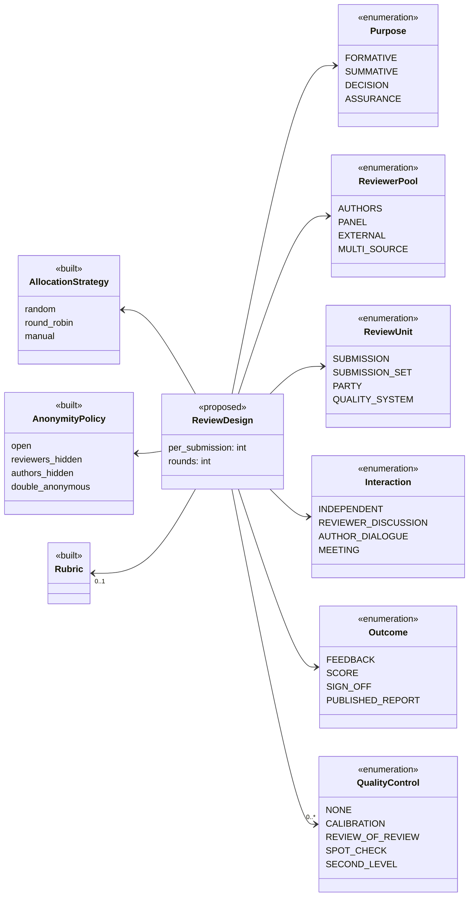
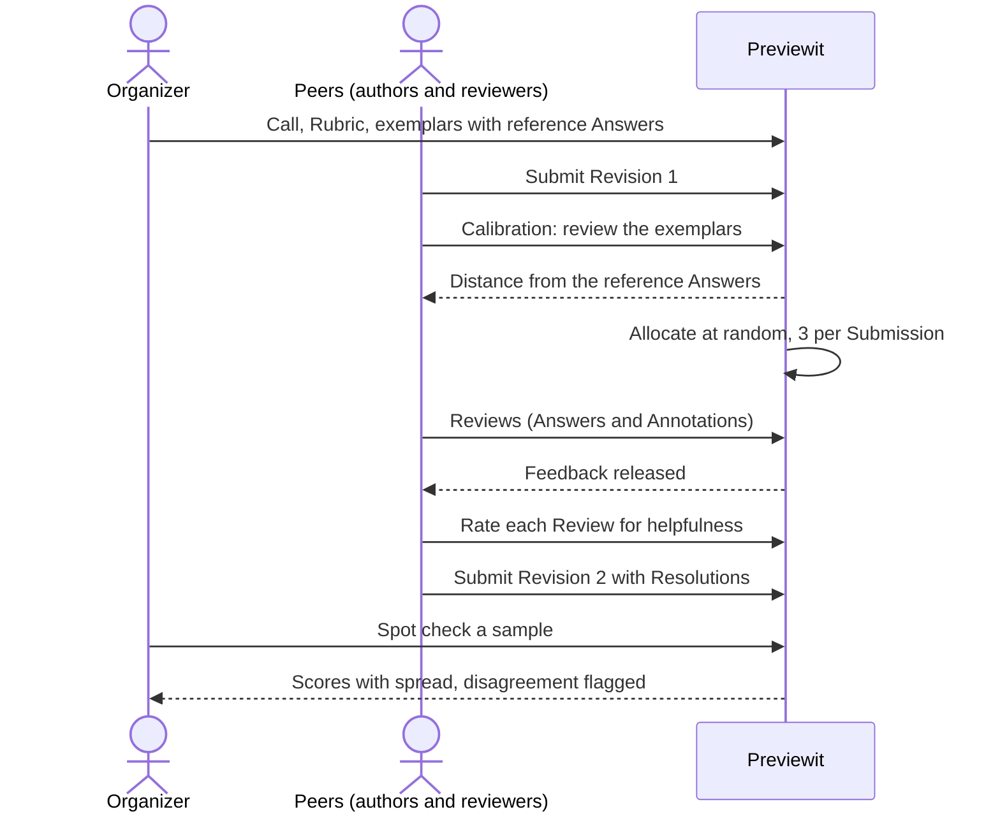
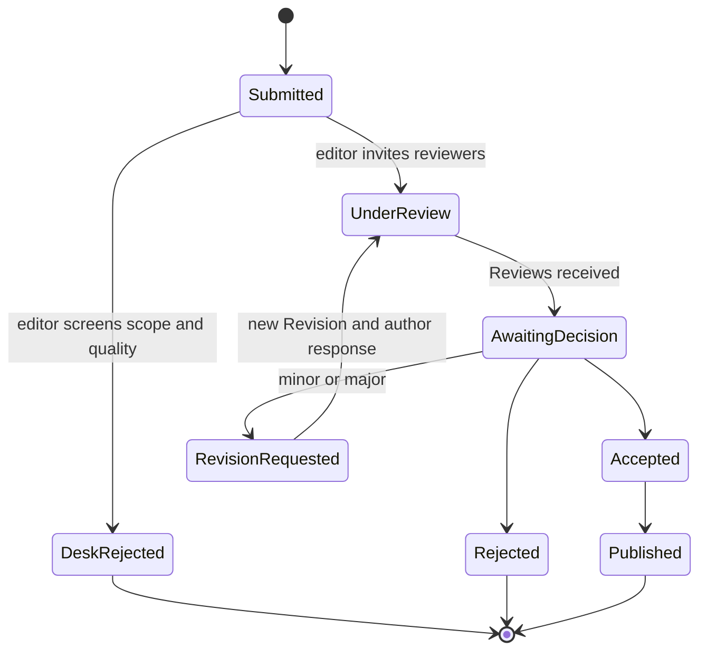
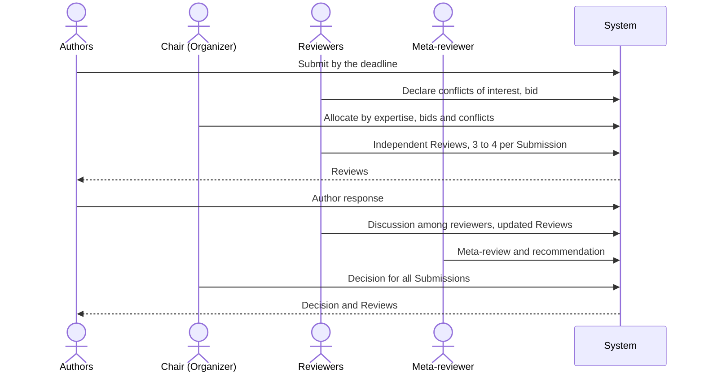
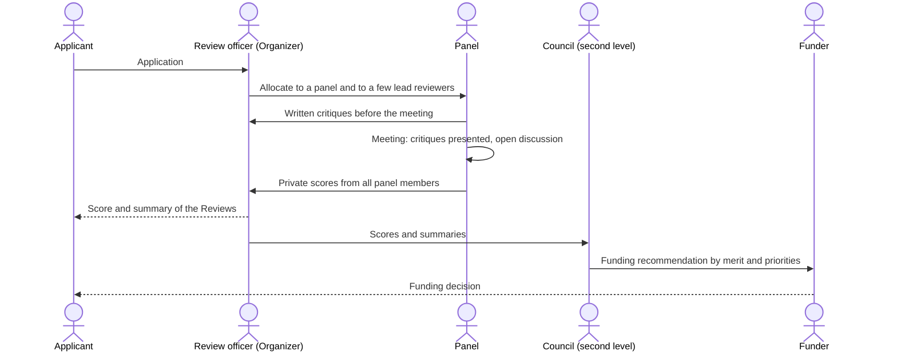
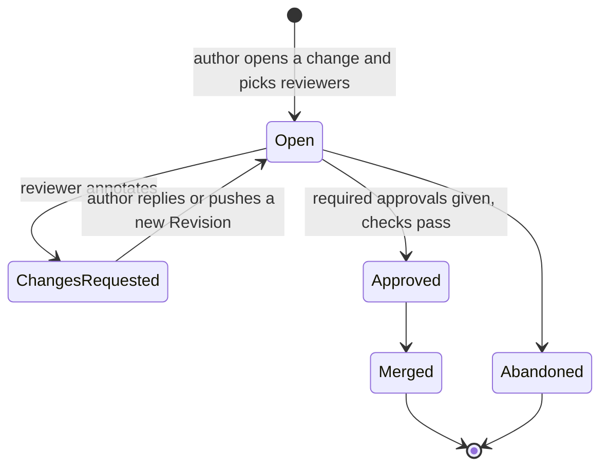
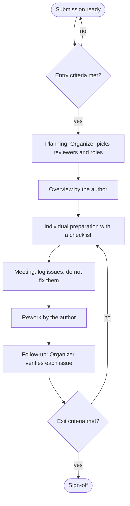
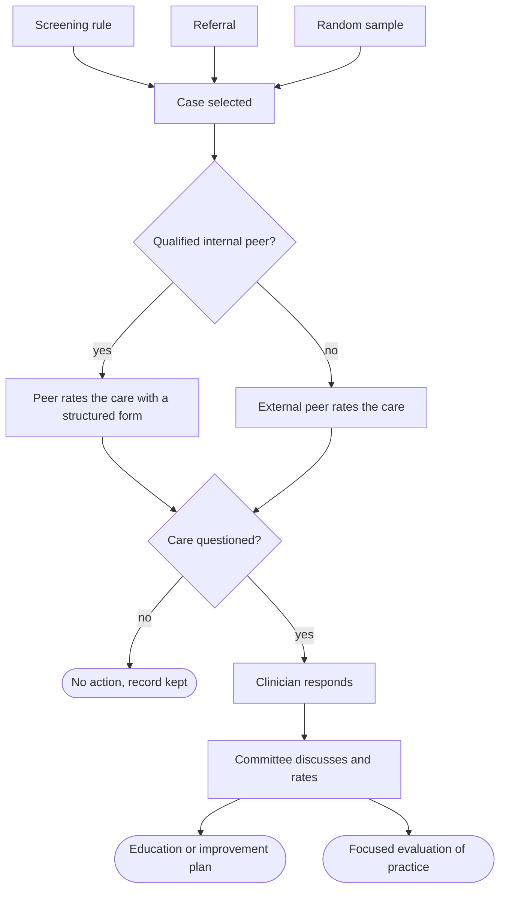
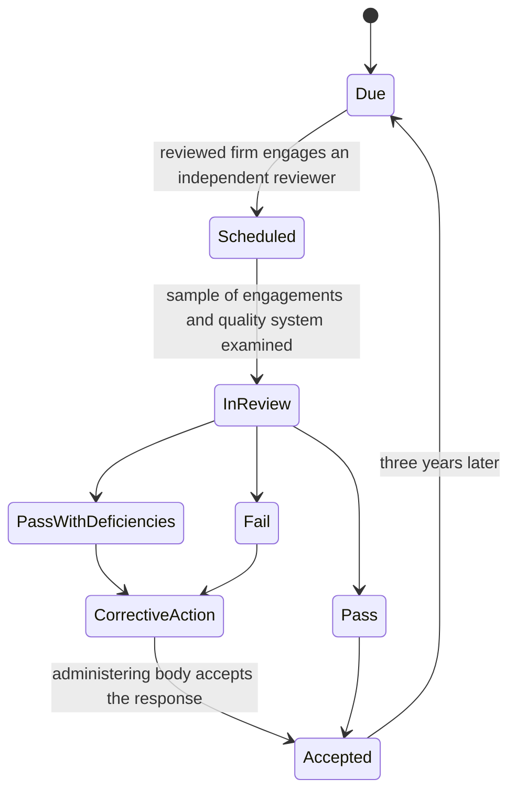
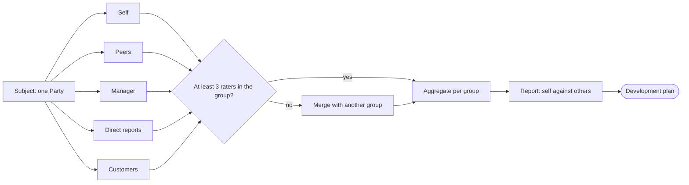

# Review designs across industries

Every industry organizes peer review differently, but each form is a **Review design**: a set of choices on the same few dimensions. This page names the dimensions, shows ten review designs from the literature as UML diagrams, and says what Previewit needs for each. The evidence is in [peer-review-literature.md](peer-review-literature.md); keys in brackets point to its reference list or to section 5 here.

Words follow the [glossary](../glossary.md). Where an industry uses another word, it is given once in quotes. Status marks follow [uml/README.md](../uml/README.md): **built**, **planned**, **deferred** (reserved in the glossary, after year 1) and **proposed** (a suggestion made here; confirm before building).

## 1. The dimensions of a review design

`ReviewDesign` is not a new entity. It is the bundle of defaults a **Preset** would supply for a Call and its Rounds, as the [glossary](../glossary.md) defines Review design.

| Dimension | Question it answers | Status in Previewit |
|---|---|---|
| Purpose | Help the author, grade, decide, or assure compliance? | Deferred (`purpose` on a Round) |
| Reviewer pool | Are reviewers the authors, a separate panel, another organization, or several rater groups? | Authors built; others by hand (ADR 0014) |
| Review unit | One Submission, a set to compare, a Party, or a whole quality system? | Submission built; others proposed |
| Reviews per Submission | How many reviewers each? | Built (`per_submission`) |
| Allocation | Who decides the pairs, and from what information? | Random, round-robin, manual built |
| Anonymity | Who sees whose identity, and when is it revealed? | Recorded (M4), applied in M6 |
| Interaction | Do reviewers work alone, discuss, talk to the author, or meet? | Independent built; author response planned (M6) |
| Instrument | Annotations, Rubric, checklist, ranking | Annotations and Rubric built; ranking proposed |
| Outcome | Feedback, a score, a Sign-off, a published report | Feedback planned (M6); Sign-off deferred |
| Quality control | Who checks the reviewers? | Calibration deferred; others proposed |

## 2. Ten review designs

### 2.1 Review by link (any industry)

One author asks one reviewer. No Rubric, no allocation, comments only. The sequence diagram is in [uml/behaviour.md](../uml/behaviour.md#review-by-link-m2-m5-m6). This is the simplest review design and the base case: every other design adds structure to it. **Built.**

### 2.2 Reciprocal Round (education)

Authors are the reviewers. Each reviews k Submissions and receives k Reviews, allocated at random, usually with reviewers hidden. The plain flow is "Organized round" in [uml/behaviour.md](../uml/behaviour.md#organized-round-m2-to-m6). The diagram below adds the quality layer that the literature supports: Calibration before reviewing [CPR, Kulk13], review-of-review after it [Patchan18], and a spot check by the Organizer [Wright15].

### 2.3 Journal (scholarly publishing)

An editor (Organizer) screens each Submission, invites two to four external reviewers by expertise, and decides. Reviewers are hidden from authors, and sometimes authors from reviewers. The loop of revision and Re-review runs until a Decision [Shah22, NISO23].

Variants: published Reviews and open identities [Ross17]; review after publication with no accept or reject Decision, where the public Reviews are the outcome [Eisen22].

### 2.4 Conference (computer science)

One deadline, a fixed reviewer pool ("program committee") and a batch Decision. Allocation uses declared expertise, bids and conflicts of interest. Reviewers work alone, then discuss; authors answer once ("rebuttal"); a second-level reviewer writes a meta-review [Shah22].

### 2.5 Grant funding (two levels)

A panel of peers ("study section") judges scientific merit and nothing else. A few allocated reviewers write critiques before the meeting; after discussion every panel member scores in private. A second body weighs the scores against programme priorities, and the funder decides [NIH].

### 2.6 Modern code review (software)

Continuous review of small changes. The author picks one or two teammates, or the owners of the code are added automatically. Identities are open, comments are Annotations on lines, and the outcome is an approval, not a score. The main benefits are shared knowledge and better solutions, more than found defects [Bacc13, Sad18, Rigby13].

### 2.7 Inspection and design gate (engineering)

A formal review with entry and exit criteria, fixed roles and a log of issues. Reviewers prepare alone with a checklist; a meeting collects issues and does not fix them; the author reworks; the Organizer ("moderator") verifies the rework [Fagan76]. Design gates in systems engineering use the same shape with an independent board, entrance and success criteria, and recommendations for action [NASA].

### 2.8 Clinical peer review (healthcare)

The unit is a case, and behind it a clinician's practice. Cases enter by screening rules, referrals or random sampling. A peer of the same specialty rates the care; contested cases go to a committee, and the clinician responds. An external reviewer is used when no internal peer qualifies. The aim is improvement, and the results feed ongoing and focused evaluation of practice [Deyo16, Spath07].

### 2.9 Firm-on-firm peer review (audit and accounting)

One organization reviews another. An independent firm, which must itself have passed, examines the reviewed firm's quality system and a sample of its engagements every three years. The report has three grades and is accepted by an administering body, which can require corrective action [AICPA].

### 2.10 Multi-source feedback (teams and human resources)

The unit is a Party, not a Submission. Several rater groups answer the same behavioural Rubric about one person. Answers are shown only in aggregate, and a group with fewer than three raters is merged with another so nobody can be identified. Practitioner guidance keeps it for development, apart from pay [NFCC]; measured improvement after such feedback is on average small [Smither05]. Teammate evaluation in project courses is the same review design with one rater group; there the scores can turn a group mark into individual marks [Ohland12].

The manager's Answers are the usual exception to the threshold: they are shown as given.

## 3. Comparison

| Review design | Purpose | Reviewer pool | Unit | Reviewers | Allocation | Anonymity | Interaction | Outcome |
|---|---|---|---|---|---|---|---|---|
| Review by link | Formative | Anyone with the link | Submission | 1 | By the author | Open | Author dialogue | Feedback |
| Reciprocal Round | Formative, sometimes summative | Authors | Submission | 3 to 5 | Random | Reviewers hidden or double-anonymous | Independent | Feedback, score |
| Journal | Decision | External experts | Submission | 2 to 4 | By the editor, on expertise | Reviewers hidden or double-anonymous | Through the editor | Decision |
| Conference | Decision | Fixed panel | Submission | 3 to 4 | Expertise, bids, conflicts of interest | Double-anonymous | Reviewer discussion, one author response | Decision |
| Grant funding | Decision | Panel, then council | Submission | A few lead reviewers; all members score | By the review officer | Reviewers hidden | Meeting | Score, then Decision |
| Code review | Formative and Sign-off | Teammates, code owners | Small change | 1 to 2 | By the author or by ownership rules | Open | Author dialogue | Sign-off |
| Inspection, design gate | Assurance | Trained team or independent board | Submission against criteria | About 4 | By the Organizer, by role | Open | Meeting | Sign-off |
| Clinical peer review | Assurance, improvement | Same-specialty peers, committee | Case, then Party | 1, then committee | Screening and sampling | Varies | Committee, clinician responds | Rating, improvement plan |
| Firm-on-firm | Assurance | Another organization | Quality system | 1 team | Chosen by the reviewed firm, administered by a professional body | Open | Report and response | Pass, pass with deficiencies, fail |
| Multi-source feedback | Formative | Rater groups | Party | 5 or more | By relationship | Raters hidden, shown in aggregate | Independent | Feedback |

Three patterns stand out:

1. **Who reviews is the main split.** Education is the main setting where authors are the reviewers. Elsewhere the pool is separate, and how it is chosen (expertise, ownership, independence) is the heart of the review design.
2. **Decisions need a second level.** Whenever review ends in a Decision or Sign-off, someone other than the reviewers makes it: editor, chair, council, committee, administering body.
3. **Anonymity follows power, not habit.** Reviewers are hidden where they judge peers who could retaliate (journals, classes, 360). Identities are open where reviewer and author share a goal and keep working together (code review, inspection).

## 4. What Previewit needs

| Capability | Status | Needed by |
|---|---|---|
| Authors as reviewers, random and round-robin allocation | Built (M4) | Reciprocal Round |
| Review by link | Built (M2) | Review by link |
| Group as author or reviewer, shared Review | Built (M5) | Reciprocal Round, inspection |
| Anonymity in four directions, with reveal | Recorded (M4); applied in M6 | All |
| Author response and Resolution | Planned (M6) | Journal, conference, code review, inspection |
| Reviewer pool separate from authors, allocated automatically | Proposed; ADR 0014 pairs outsiders by hand | All except review by link and the reciprocal Round |
| Expertise, bids and conflicts of interest in allocation | Deferred (year 2) | Journal, conference, grant funding |
| Discussion among reviewers (Consensus review) | Deferred | Conference, grant funding, inspection, clinical |
| Sign-off and Decision | Deferred | Journal, conference, grant funding, code review, inspection, firm-on-firm |
| Second level: a Review of the Reviews by another Party | Proposed | Conference, grant funding, clinical, firm-on-firm |
| Calibration | Deferred | Reciprocal Round, grant funding |
| Review-of-review and spot checks | Proposed | Reciprocal Round |
| Entry and exit criteria as a checklist on the Call | Proposed; a "Quick check" Rubric covers part | Inspection, design gate |
| Sampling: allocate reviewers to a sample of Submissions | Proposed | Clinical, firm-on-firm |
| Party as the review unit | Proposed; blocked by ADR 0014 | Multi-source feedback, teammate evaluation, clinical |
| Aggregate-only release with a minimum number of raters | Proposed | Multi-source feedback |
| Review across organizations | Deferred (ADR 0006) | Firm-on-firm, journal |
| Live meetings | Out of scope; Previewit is asynchronous | Inspection, grant funding |

For meeting-based review designs Previewit can still carry the asynchronous parts: preparation, the issue log as Annotations, rework and follow-up.

**Suggested order after the Education preset:** (1) a separate reviewer pool, because eight of the ten review designs need it; (2) Sign-off with a second level, which opens journals, conferences and inspections; (3) Party as the review unit, which opens teammate evaluation, the nearest neighbour of the first market.

## 5. Sources added on this page

Other keys are in [peer-review-literature.md](peer-review-literature.md#references). The sources for 360 feedback and firm-on-firm review are practitioner and regulator material, not controlled studies.

- [AICPA] AICPA Peer Review Program: system and engagement reviews, three-year cycle, three grades. aicpa-cima.com/news/article/peer-review-a-vital-component-in-audit-quality; reviewer requirements at journalofaccountancy.com/issues/2015/dec/cpa-peer-review-standards/
- [Deyo16] Deyo-Svendsen et al. (2016). A systematic approach to clinical peer review in a critical access hospital. pmc.ncbi.nlm.nih.gov/articles/PMC5054974
- [Fagan76] Fagan (1976). Design and code inspections to reduce errors in program development. *IBM Syst. J.* 15(3). Steps and roles summarized at en.wikipedia.org/wiki/Fagan_inspection
- [NASA] NASA NPR 7123.1, Systems Engineering Processes and Requirements, Appendix G (entrance and success criteria); NASA Preferred Practice PD-ED-1215.4, Common review methods for engineering products
- [NFCC] National Fire Chiefs Council. Guide to 360-feedback. nfcc.org.uk/our-services/people-programme/guide-to-360-feedback-individual/
- [NIH] National Institutes of Health. Peer review: first level (scientific review group) and second level (advisory council). grants.nih.gov
- [Rigby13] Rigby & Bird (2013). Convergent contemporary software peer review practices. *ESEC/FSE*
- [Smither05] Smither, London & Reilly (2005). Does performance improve following multisource feedback? *Pers. Psychol.* 58(1)
- [Spath07] Spath (2007). Fortifying individual case review activities. clinician.com/articles/106387
