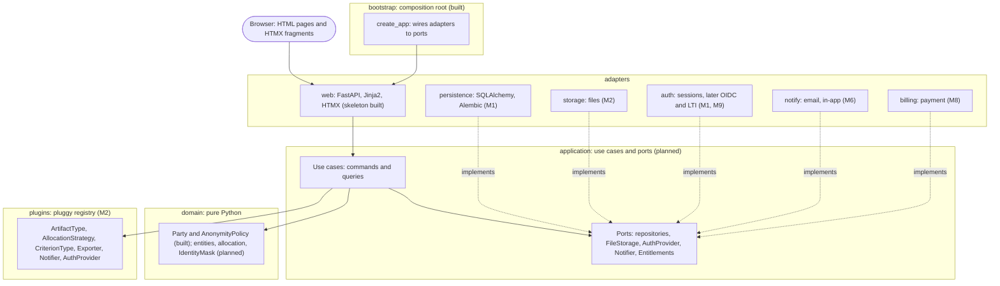

# Architecture

Hexagonal modular monolith ([ADR 0001](../adr/0001-hexagonal-modular-monolith.md)): one deployable, strict layers. Imports point downward only; `make layers` enforces it.



## Rules the diagram encodes

| Rule | Where |
|---|---|
| `domain` and `application` import no FastAPI, Jinja2, SQLAlchemy or I/O | `pyproject.toml`, import-linter |
| The server returns HTML; no JSON API, no SPA | [ADR 0002](../adr/0002-hypermedia-htmx.md) |
| The core never imports a plugin; it asks the registry | `PLAN.md` section 3 |
| Limits (50 MB, 100 shares) go through the `Entitlements` port | `CLAUDE.md` |
| Only `IdentityMask` turns a Party into a display name | `PLAN.md` section 2.2 |
| Built-in text and PDF types are plugins too | `PLAN.md` section 1 |

## Source layout

```
src/previewit/
  bootstrap.py     composition root
  domain/          party.py, anonymity.py
  application/     (empty)
  adapters/web/    app.py, templates/, static/
  plugins/         (empty)
tests/             unit, integration, acceptance
```
