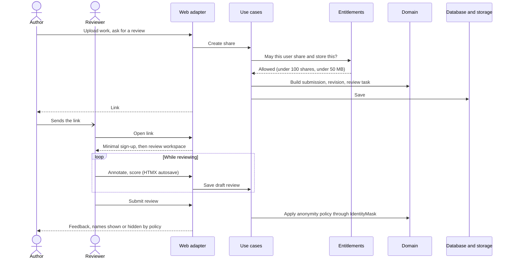
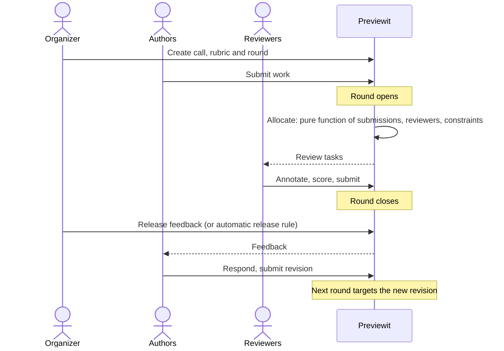
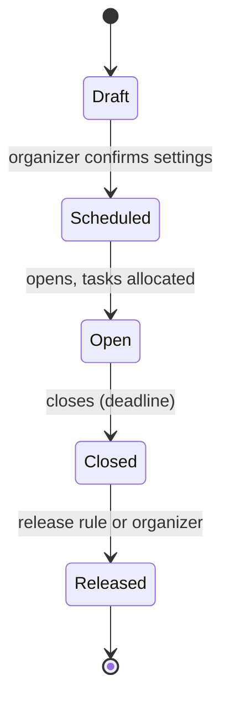
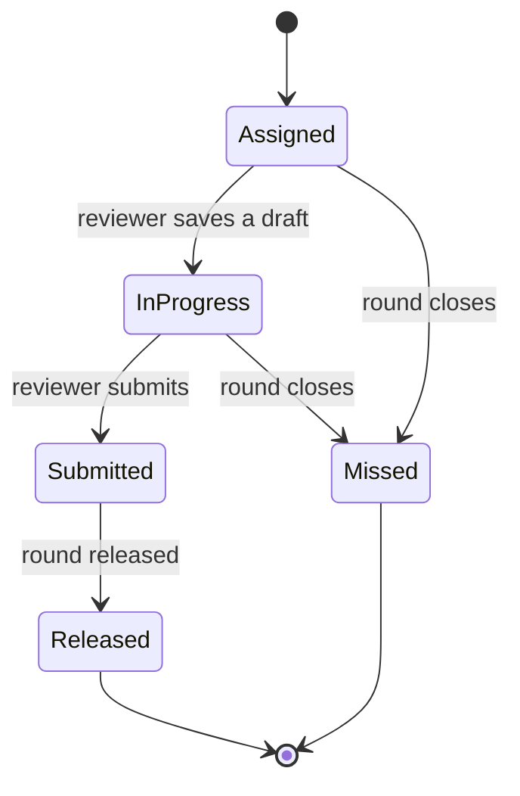

# Behaviour

All flows are planned. Messages are written in plain words, not as function names; names are chosen when the code is written.

## Review by link (M2, M5, M6)

The growth flow: one person asks another for a review with a link.

## Organized round (M2 to M6)

Allocation invariants (property-tested): no self-review, no review of own group, exact number of reviews, balanced load.

## Review round lifecycle (proposed)

`PLAN.md` defines deadlines, release rules and rounds, but no named states. These are a proposal.

A later round is a new `ReviewRound` that targets a later revision.

## Review task lifecycle (proposed)

