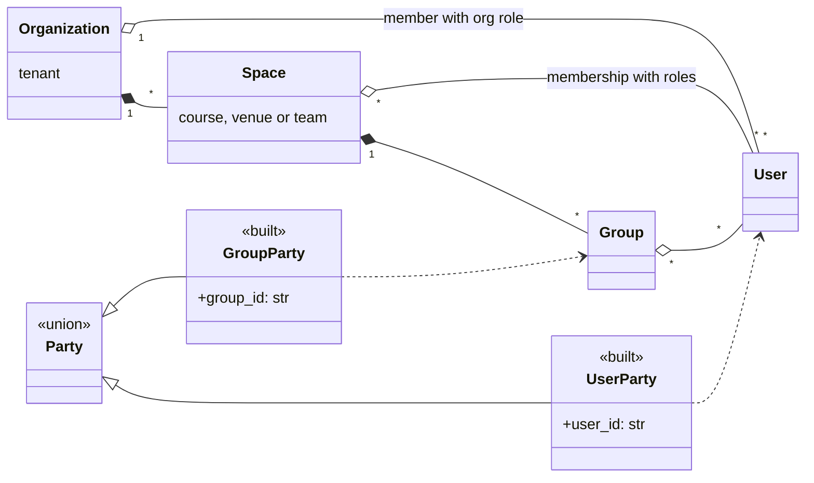
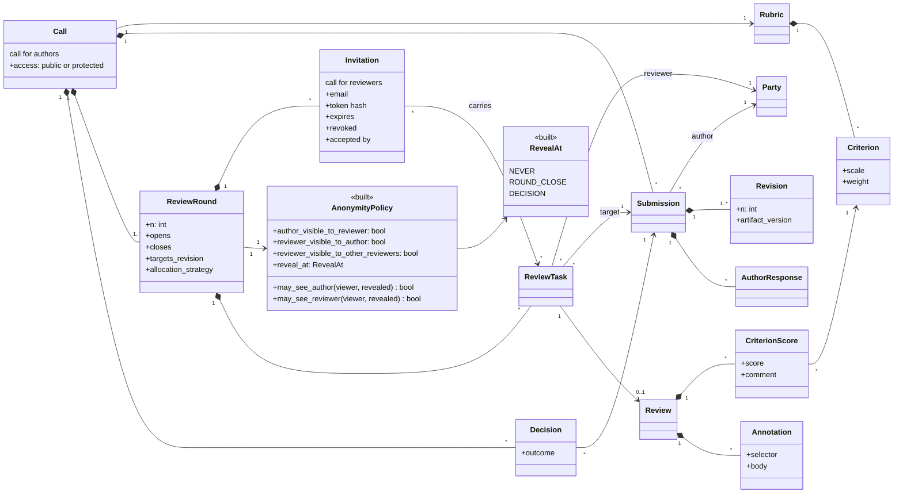

# Domain model

Source: `PLAN.md` section 2. Classes marked `built` exist in `src/previewit/domain/`; the rest are planned.

## Tenancy and parties

- A **Party** is the author of a submission or the writer of a review. Because both sides are a Party, all four directions work: user to user, user to group, group to user, group to group.
- There are three fixed roles in a Space, **organizer**, **author** and **reviewer**, and a Member holds a set of them ([ADR 0017](../adr/0017-actors-calls-and-invitations.md)). Presets only rename them. An auditor role is reserved. Every tenant-owned row carries `org_id`.
- Organizations as parties are deferred ([ADR 0006](../adr/0006-organizations-as-parties-deferred.md)).

## Calls, rounds and reviews

- **Call** is the call for authors. Its link is public (the plain URL) or protected (the URL with the token). An **Invitation** is one personal link of the call for reviewers: bound to an email, with its own token, carrying the review tasks of that reviewer. `Call.access` exists (step C): a protected call's token is a share link. `Invitation` exists (step D): its tasks are created when the invited person opens it.
- **Artifact** content is type-specific (text, PDF) and comes from a plugin. Versions are immutable, so annotations are pinned to a revision and never drift.
- **Annotation selector** is polymorphic: quote and offset for text, page and rectangles for PDF.
- **Cardinality is allocation.** One `ReviewTask` links one reviewer Party to one Submission; 1:1, 1:n, n:1 and n:n are choices of the allocation strategy.
- **Decision** and conflict-of-interest handling belong to the academic-venue preset (year 2).
