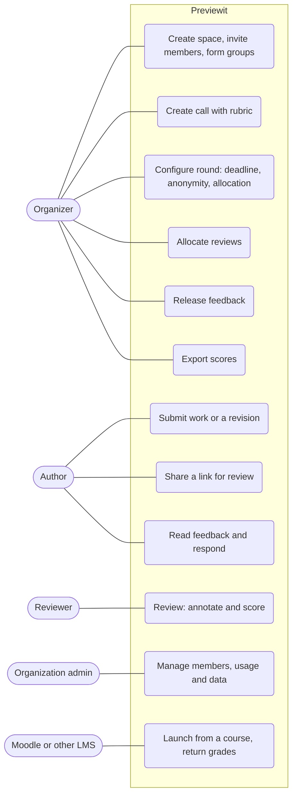

# Use cases

All planned; milestones in the table. Author and Reviewer are **Parties**: a user or a group. One person is often both.

| Use case | Milestone | Notes |
|---|---|---|
| Create space, invite members, form groups | M1 | Education preset: space = course |
| Create call with rubric | M2, M3 | Call = assignment |
| Submit work or a revision | M2 | Text and PDF; individual or group |
| Share a link for review | M2 | Minimal sign-up; counts toward the 100-share free limit |
| Configure round, allocate reviews | M4 | Random, round-robin, manual; never self or own group |
| Review: annotate and score | M5 | One shared review per reviewing group |
| Release feedback, read and respond | M6 | Identities shown only as the anonymity policy allows |
| Export scores | M7 | CSV, for the Moodle gradebook |
| Manage members, usage and data | M1, M8 | Quotas: 50 MB, 100 shares; GDPR export and deletion |
| Launch from a course, return grades | M9 | LTI 1.3 |
